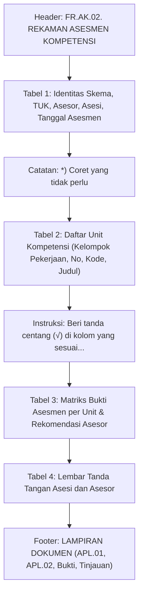

# LAPORAN AUDIT DAN PERANCANGAN TEMPLATE FR.AK.02
**Dokumen**: `FR.AK.02 — Rekaman Asesmen Kompetensi`  
**Proyek**: LSP Certification Management (`lsp-certification-management`)  
**Mode**: AUDIT ONLY — ZERO CODE MODIFICATION  
**Tanggal**: 24 Oktober 2026  
**Status**: AUDIT SELESAI — MENUNGGU PERSETUJUAN (STOP CONDITION AKTIF)

---

## 1. IDENTIFIKASI JUDUL DAN KODE FORMULIR

Berdasarkan berkas template resmi yang diunggah (`media_1792852974271_93edf3b1.docx` / input prompt):

| Atribut | Nilai Resmi pada Template | Keterangan / Analisis |
|---|---|---|
| **Kode Dokumen** | `FR.AK.02.` | Kode resmi formulir BNSP untuk Rekaman Asesmen |
| **Judul Dokumen** | `REKAMAN ASESMEN KOMPETENSI` | Judul baku instrumen pencatatan hasil asesmen per asesi |
| **Sifat Dokumen** | Dokumen per Asesi / Pendaftaran | Berisi hasil evaluasi satu orang peserta spesifik oleh asesor penilai |
| **Lampiran Terkait** | APL.01, APL.02, Bukti Berkualitas, Tinjauan Proses Asesmen | Dicantumkan pada bagian akhir dokumen sebagai referensi audit dokumen |

---

## 2. STRUKTUR DOKUMEN DAN ELEMEN FORMULIR

Template `FR.AK.02` terdiri atas 4 tabel utama dan 3 blok teks pendukung:

### Rincian Tabel:

### A. Tabel 1 — Identitas Pelaksanaan Asesmen
| Baris | Kolom Label | Tanda | Kolom Isian / Opsi |
|---|---|---|---|
| 1 | Skema Sertifikasi (KKNI/Okupasi/Klaster)* — Judul | : | `[Judul Skema Sertifikasi]` |
| 2 | Skema Sertifikasi — Nomor | : | `[Nomor / Kode Skema Sertifikasi]` |
| 3 | TUK | : | `☑ Sewaktu` &nbsp;&nbsp; `☐ Tempat Kerja` &nbsp;&nbsp; `☐ Mandiri*` |
| 4 | Nama Asesor | : | `[Nama Lengkap Asesor Penguji]` |
| 5 | Nama Asesi | : | `[Nama Lengkap Peserta / Asesi]` |
| 6 | Tanggal Asesmen — Mulai | : | `[Tanggal Mulai Pelaksanaan Kegiatan]` |
| 7 | Tanggal Asesmen — Selesai | : | `[Tanggal Selesai Pelaksanaan Kegiatan]` |

> Catatan di bawah Tabel 1: `*) Coret yang tidak perlu`

### B. Tabel 2 — Daftar Unit Kompetensi Skema
- **Kolom 1** (rowspan semua unit): `Kelompok Pekerjaan … \n ….…………… \n ….……………`
- **Kolom 2**: `No.` (1, 2, 3, ... N)
- **Kolom 3**: `Kode Unit` (misal: `M.74FTG00.001.3`)
- **Kolom 4**: `Judul Unit` (misal: `Mengelola Gagasan Konsumen`)

### C. Tabel 3 — Matriks Bukti Asesmen, Rekomendasi, dan Ulasan Asesor
- **Teks Pengantar**: *Beri tanda centang (√) di kolom yang sesuai untuk mencerminkan bukti yang sesuai untuk setiap Unit Kompetensi.*
- **Kolom Header**:
  1. `Unit Kompetensi` (No urut 1, 2, ... N sinkron dengan Tabel 2)
  2. `Observasi Demonstrasi`
  3. `Portofolio`
  4. `Pernyataan Pihak Ketiga Pertanyaan Wawancara`
  5. `Pertanyaan Lisan`
  6. `Pertanyaan Tertulis`
  7. `Proyek Kerja`
  8. `Lainnya`
- **Baris Unit (1..N)**: Tiap unit memiliki checkbox kosong `☐` pada ke-7 kolom jenis bukti untuk dicentang asesor.
- **Baris Tambahan (Bagian Rekomendasi & Catatan Asesor)**:
  - `Rekomendasi hasil asesmen`: `☐ Kompeten / ☐ Belum kompeten` (colspan 7).
  - `Tindak lanjut yang dibutuhkan (Masukkan pekerjaan tambahan dan asesmen yang diperlukan untuk mencapai kompetensi)`: area kosong untuk tulisan tangan/catatan asesor (colspan 7).
  - `Komentar/Observasi oleh asesor`: area kosong untuk tulisan tangan/catatan asesor (colspan 7).

### D. Tabel 4 — Tanda Tangan dan Pengesahan
- **Bagian Asesi**:
  - `Nama`: `[Nama Lengkap Asesi]`
  - `Tanda tangan dan Tanggal`: Area tanda tangan basah & tanggal pelaksanaan manual.
- **Bagian Asesor**:
  - `Nama`: `[Nama Lengkap Asesor]`
  - `No. Reg.MET.`: `[Nomor Registrasi MET Asesor]`
  - `Tanda tangan dan Tanggal`: Area tanda tangan basah & tanggal manual.

### E. Catatan Kaki / Lampiran Dokumen
Daftar checklist lampiran dokumen pendukung asesmen:
- `LAMPIRAN DOKUMEN:`
  - Dokumen APL 01 peserta
  - Dokumen APL 02 peserta
  - Bukti-bukti berkualitas peserta
  - Tinjauan proses asesmen

---

## 3. MATRIKS SUMBER DATA SISTEM

| Elemen Formulir | Sumber Data Sistem | Nama Field / Method | Status Ketersediaan |
|---|---|---|---|
| **Judul Skema** | Master Skema (`LSP Core Management`) | `$skema['title']` via `LSP_Cert_Integration::get_skema()` | ✅ Sudah tersedia |
| **Nomor Skema** | Master Skema (`LSP Core Management`) | `$skema['kode']` via `LSP_Cert_Integration::get_skema()` | ✅ Sudah tersedia |
| **Jenis TUK** | Kebijakan Dokumen Cetak (Phase AK-01C) | Default seragam: `☑ Sewaktu`, `☐ Tempat Kerja`, `☐ Mandiri*` | ✅ Sudah terstandarisasi |
| **Nama Asesor** | Data Penugasan Asesor / Tim Asesor | `$asesor['name']` via `pendaftaran->asesor_id` (fallback ke kegiatan) | ✅ Sudah tersedia |
| **No. Reg.MET Asesor** | Metadata User Asesor | `$asesor['no_reg']` (ambil `nomor_met`) | ✅ Sudah tersedia |
| **Nama Asesi** | Data Pendaftaran Peserta | `$pendaftaran->nama_lengkap` | ✅ Sudah tersedia |
| **Tanggal Asesmen Mulai** | Data Kegiatan Sertifikasi | `$kegiatan->tanggal_pelaksanaan` | ✅ Sudah tersedia |
| **Tanggal Asesmen Selesai**| Data Kegiatan Sertifikasi | `$kegiatan->tanggal_pelaksanaan` | ✅ Sudah tersedia |
| **Daftar Unit Kompetensi** | Master Skema SKKNI | `LSP_Cert_Integration::get_unit_kompetensi( $skema_id )` | ✅ Sudah tersedia dinamis |
| **TUK Penyelenggara** | Master TUK & Data Kegiatan | `$kegiatan->tuk_id`, `$kegiatan->lokasi_uji` | ✅ Sudah tersedia |

---

## 4. DAFTAR ISIAN MANUAL (STRICTLY MANUAL)

Demi mematuhi regulasi BNSP dan menjaga integritas hasil uji sertifikasi, kolom-kolom berikut **DILARANG DIISI OTOMATIS** oleh sistem dan wajib dicetak kosong untuk diisi langsung oleh Asesor:

1. **Centang Bukti per Unit Kompetensi (Tabel 3)**:
   - Observasi Demonstrasi: `☐`
   - Portofolio: `☐`
   - Pernyataan Pihak Ketiga Pertanyaan Wawancara: `☐`
   - Pertanyaan Lisan: `☐`
   - Pertanyaan Tertulis: `☐`
   - Proyek Kerja: `☐`
   - Lainnya: `☐`
2. **Keputusan Rekomendasi Hasil Asesmen**:
   - `☐ Kompeten`
   - `☐ Belum kompeten`
3. **Tindak Lanjut yang Dibutuhkan**: Dikosongkan sebagai area catatan/tulis tangan asesor.
4. **Komentar/Observasi oleh Asesor**: Dikosongkan sebagai area catatan/tulis tangan asesor.
5. **Tanda Tangan & Tanggal Asesi**: Ruang kosong tanda tangan basah & isian tanggal manual (`Tanggal : ………………………………`).
6. **Tanda Tangan & Tanggal Asesor**: Ruang kosong tanda tangan basah & isian tanggal manual (`Tanggal : ………………………………`).

---

## 5. ANALISIS UNIT KOMPETENSI (TASK 4)

- **Sumber Data Unit**: Menggunakan fungsi resmi plugin `LSP_Cert_Integration::get_unit_kompetensi( $skema_id )`.
- **Dinamisasi Baris**:
  - Pada skema `Videografer` (contoh pada template): Terdapat 11 unit kompetensi.
  - Pada skema `Social Media Marketing` (ID 26): Terdapat 7 unit kompetensi.
  - Pada skema `Content Creator` (ID 117): Terdapat unit kompetensi sesuai master skema.
- **Konsistensi Antar-Tabel**:
  - **Tabel 2** menampilkan seluruh unit secara berurutan: nomor, kode unit, dan judul unit lengkap tanpa pembatasan statis. Kolom `Kelompok Pekerjaan …` menggunakan atribut HTML `rowspan="<?php echo count( $units_skkni ); ?>"` agar membentang sempurna di sisi kiri.
  - **Tabel 3** menampilkan baris bernomor `1, 2, ... N` yang sama persis dengan urutan Tabel 2, diikuti oleh 7 checkbox bukti kosong.
- **Kesimpulan**: Struktur unit kompetensi sepenuhnya kompatibel dengan arsitektur Master Skema yang telah berjalan pada APL.01, APL.02, MAPA.01, dan MAPA.02.

---

## 6. MEKANISME CETAK DAN RANCANGAN GENERATOR

### A. Tipe Dokumen: Dokumen Per Peserta
FR.AK.02 adalah dokumen individual asesi karena mencatat hasil penilaian kompetensi spesifik untuk asesi tersebut. Dokumen ini terikat pada `$pendaftaran_id`.

### B. Modifikasi Arsitektur yang Diperlukan (Pada Phase AK-02B):
1. **Pendaftaran Dokumen**:
   - Daftarkan `'ak02' => 'FR.AK.02 - Rekaman Asesmen Kompetensi'` pada method `LSP_Cert_Document_Printer::get_available_documents()`.
2. **Template View**:
   - Buat file template: `templates/docs/form-ak02.php`.
   - Mengikuti struktur HTML dan styling baku (`lsp-doc-table`, `lsp-table-bordered`, `font-family: Arial Narrow, sans-serif`).
3. **Penyambungan Layout**:
   - Tambahkan case `'ak02'` pada `templates/docs/document-layout.php`.
   - CSS cetak A4 terisolasi (`.lsp-page-ak02`) dengan pagination `page-break-inside: avoid` pada blok tanda tangan dan rekomendasi.
4. **UI Admin**:
   - Tambahkan tombol pintas cetak "🖨️ Cetak FR.AK.02" pada halaman rincian pendaftaran (`admin/views/pendaftaran-detail.php`).

---

## 7. IDENTIFIKASI RISIKO DAN RANCANGAN PENGUJIAN

### A. Identifikasi Risiko
| Risiko | Dampak | Mitigasi |
|---|---|---|
| **Pemisahan Halaman (Page Break)** | Tabel 3 terpotong janggal di tengah baris unit atau tanda tangan terpisah sendiri di halaman baru tanpa konteks. | Pasang rule CSS `@media print { tr { page-break-inside: avoid; } .lsp-ak02-rekomendasi-box { page-break-inside: avoid; } }`. |
| **Perbedaan Jumlah Unit Kompetensi** | Tabel 2 dan Tabel 3 memiliki jumlah baris berbeda jika di-loop terpisah. | Gunakan array `$units_skkni` yang sama untuk kedua tabel, dengan indeks `1..count($units_skkni)`. |
| **Pelanggaran Kebijakan TUK** | Tampil checkbox tidak seragam dengan AK-01C. | Gunakan policy seragam yang sudah disepakati: `☑ Sewaktu`, `☐ Tempat Kerja`, `☐ Mandiri*`. |
| **Kebocoran Hak Akses Dokumen** | Pengguna luar dapat melihat hasil rekaman asesmen peserta. | Wajibkan verifikasi capabality `current_user_can('manage_options') || current_user_can('asesor')` via `render_print_page()`. |
| **Regresi Dokumen Sebelumnya** | Perubahan document printer mengganggu APL.01, APL.02, MAPA.01, MAPA.02, atau AK.01. | Lakukan regression testing otomatis menyeluruh terhadap seluruh 7 dokumen sebelum rilis. |

### B. Rancangan Pengujian Otomatis (Phase AK-02B Suite)
Akan dibuat skrip verifikasi otomatis `test_ak02_suite.php` yang menguji minimal 18 skenario:
1. `AK02-01`: Pendaftaran dokumen `ak02` pada Document Printer.
2. `AK02-02`: Render HTML berhasil tanpa PHP error / warning / notice.
3. `AK02-03`: Header dokumen memuat teks resmi `FR.AK.02. REKAMAN ASESMEN KOMPETENSI`.
4. `AK02-04`: Judul dan nomor skema sertifikasi terisi otomatis sesuai skema kegiatan.
5. `AK02-05`: Nama asesi terisi otomatis sesuai pendaftaran.
6. `AK02-06`: Nama asesor terisi otomatis sesuai penugasan/tim kegiatan.
7. `AK02-07`: Nomor MET asesor terisi otomatis pada Tabel 4.
8. `AK02-08`: Checkbox jenis TUK seragam (`☑ Sewaktu  ☐ Tempat Kerja  ☐ Mandiri*`).
9. `AK02-09`: Tanggal asesmen mulai dan selesai terisi tanggal kegiatan.
10. `AK02-10`: Tabel 2 menampilkan seluruh unit kompetensi secara dinamis.
11. `AK02-11`: Kolom `Kelompok Pekerjaan` membentang vertikal sesuai jumlah unit.
12. `AK02-12`: Tabel 3 memuat baris bukti sebanyak jumlah unit kompetensi.
13. `AK02-13`: Seluruh checkbox bukti asesmen berstatus kosong (`☐`).
14. `AK02-14`: Checkbox rekomendasi `Kompeten` dan `Belum kompeten` keduanya kosong (`☐`).
15. `AK02-15`: Kolom tindak lanjut dan komentar asesor kosong untuk tulisan tangan.
16. `AK02-16`: Tanda tangan dan tanggal asesi/asesor berupa baris manual kosong.
17. `AK02-17`: Proteksi hak akses (HTTP 403 untuk guest/unauthorized).
18. `AK02-18`: Regression test: seluruh dokumen terdahulu (APL.01, APL.02, MAPA.01 Obs/DIT/VP, MAPA.02, AK.01) tetap 100% PASS.

---

## 8. STATUS STOP CONDITION

Sesuai instruksi:
- **Audit selesai**: Seluruh pemetaan template, sumber data, dan rencana implementasi telah terdokumentasi lengkap.
- **Tidak ada kode yang diubah**: File plugin inti, skema database, dan sistem cetak tetap utuh tanpa modifikasi.
- **Status saat ini**: **STOP**. Menunggu peninjauan dan persetujuan pengguna sebelum melangkah ke tahap implementasi (Phase AK-02B).
